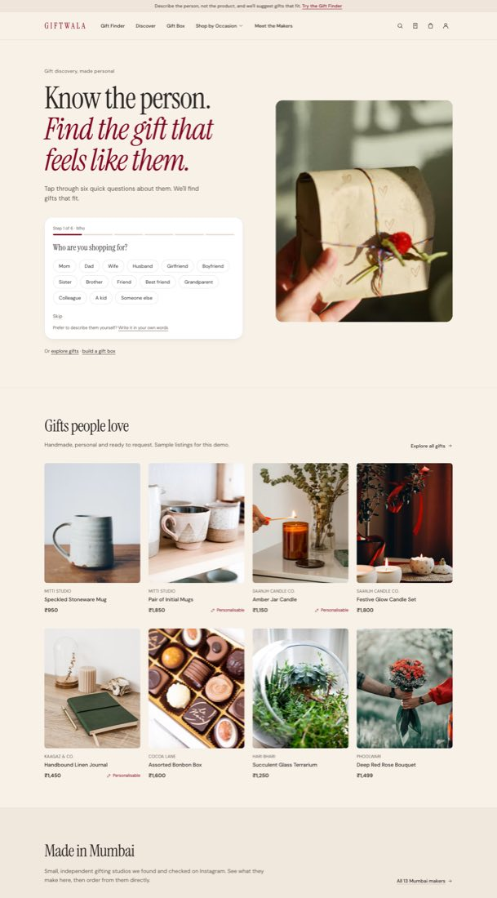
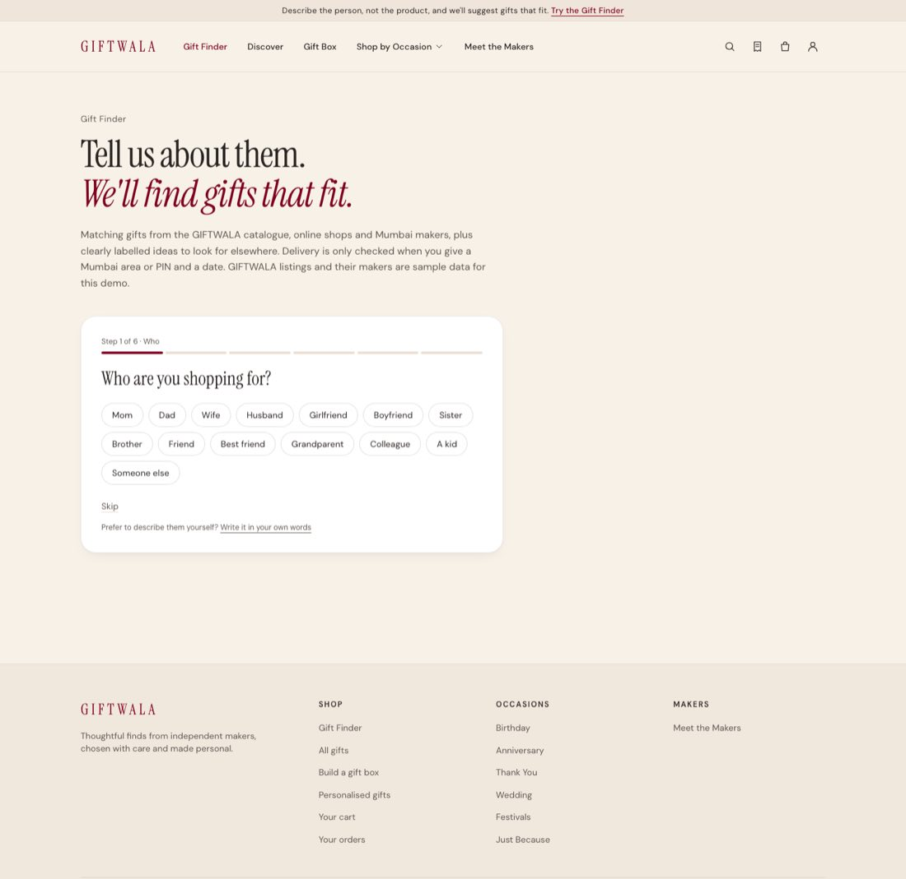
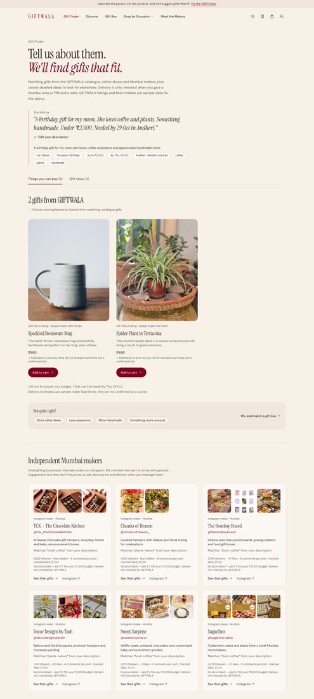
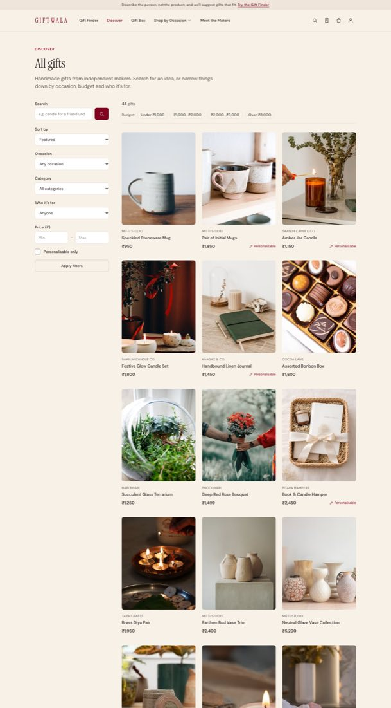
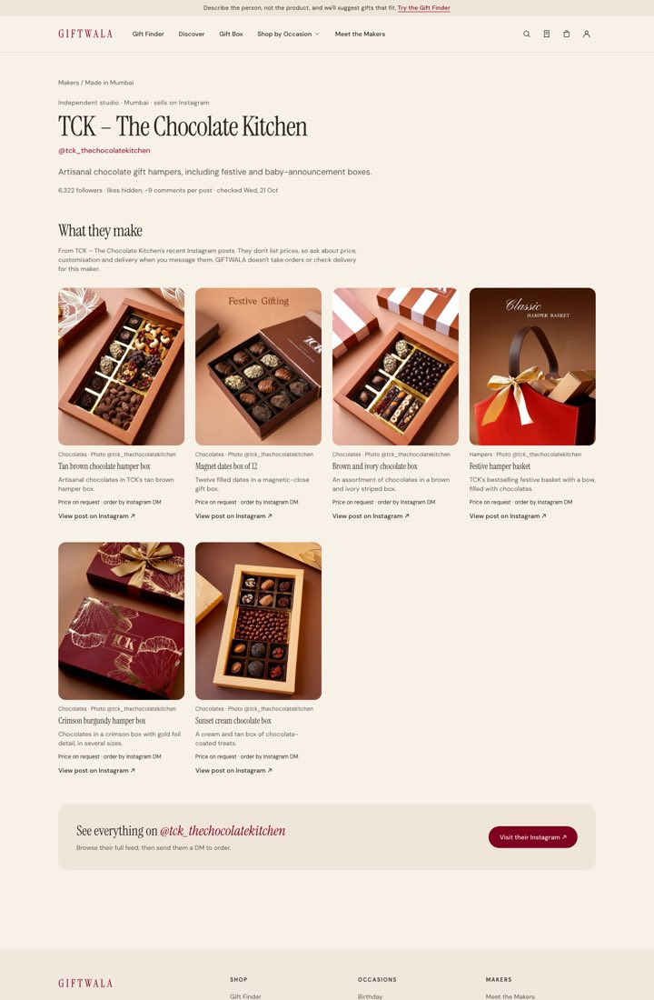
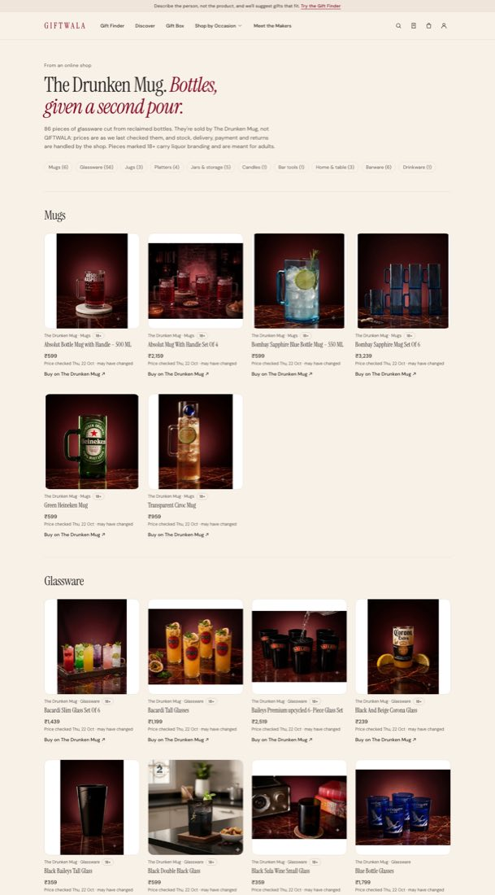
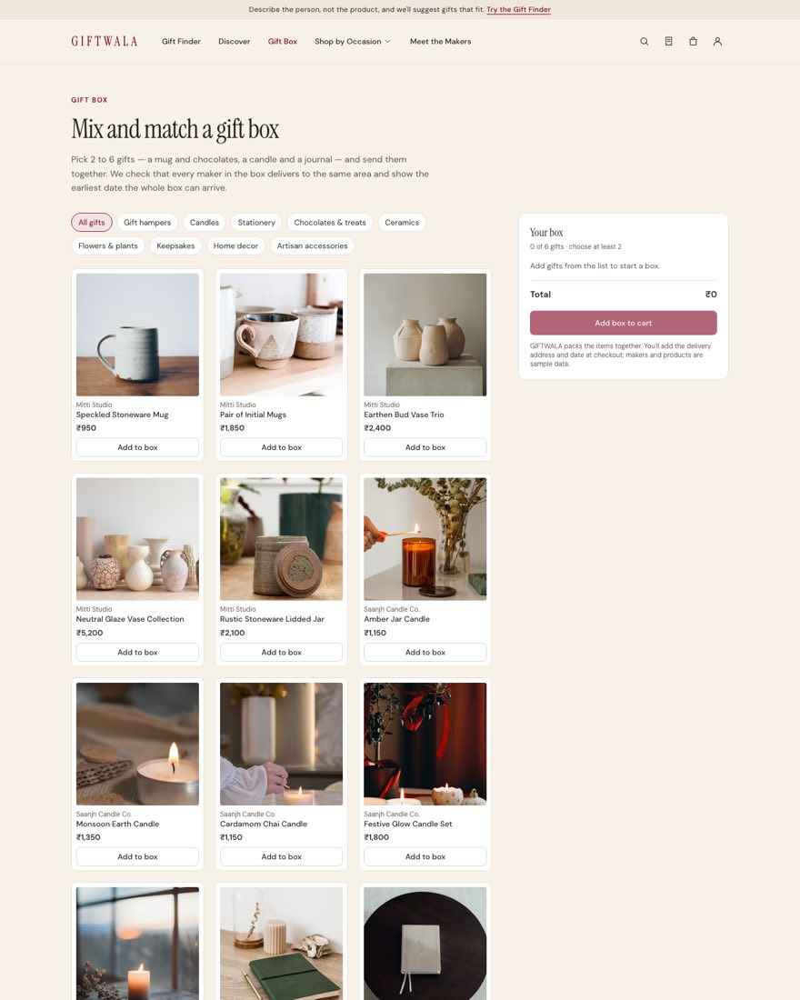
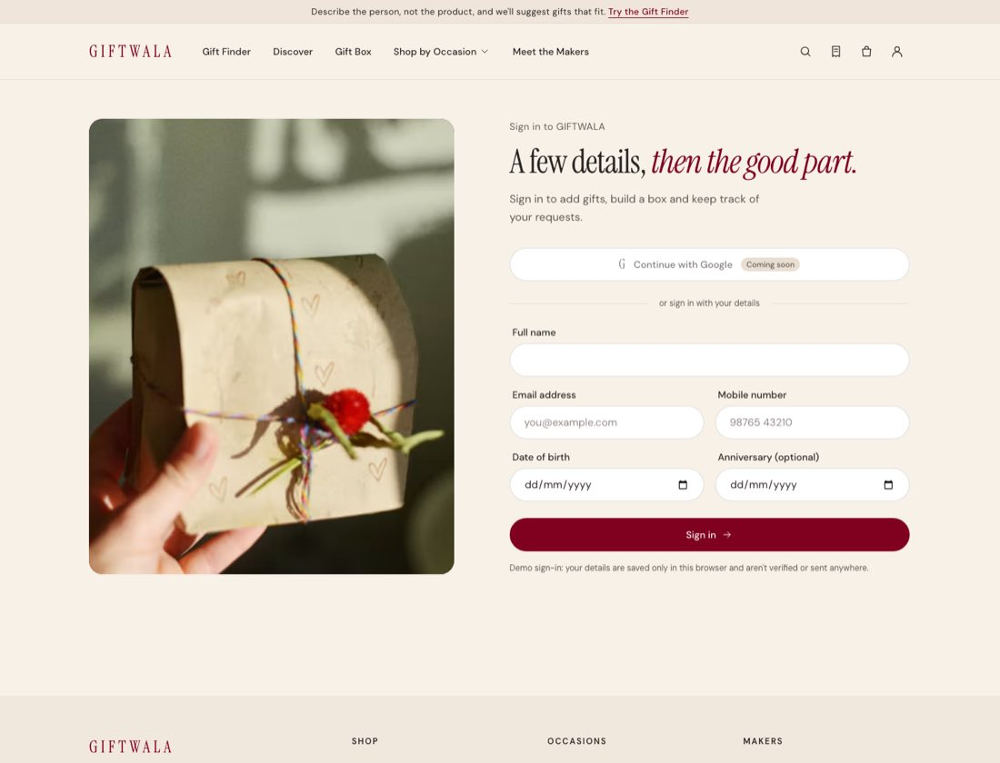
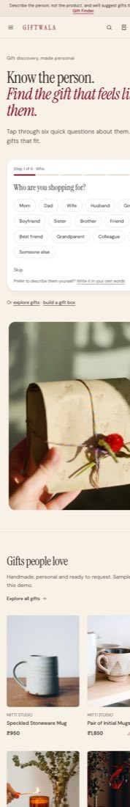

# GIFTWALA: proof of progress

These screenshots were taken on 22 Oct 2026 from the live prototype at **https://giftwala-xi.vercel.app**. The full progress report is in [PROGRESS_REPORT.md](PROGRESS_REPORT.md).

## 1. Homepage with the guided Gift Finder

Shoppers tap through six quick questions instead of typing.

## 2. Gift Finder, step 1: who are you shopping for?

## 3. Results chosen by Gemini

Brief: a birthday gift for my mom, who loves coffee and plants; handmade, under ₹2,000, needed by 29 Oct in Andheri. Fixed rules check the budget, date and delivery area before the AI picks gifts. Real Mumbai makers are listed below the results.

## 4. Discover: the catalogue, Mumbai makers and The Drunken Mug

## 5. A Mumbai maker's page

The page lists the products from their Instagram posts, followed by a "Visit their Instagram" button.

## 6. The Drunken Mug: 86 products from the shop's feed

## 7. Mix-and-match gift box

## 8. Sign-in

Name, email, mobile and date of birth are required; the anniversary is optional.

## 9. Homepage on a phone

The checkout flow is also live but not shown here. It goes from the cart to the delivery and billing addresses, then review and confirm, then a simulated payment (UPI, card or netbanking), then the order confirmation.
